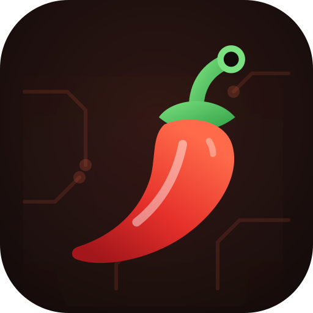

<p align="center"></p>

<h1 align="center">Chili Lab</h1>

<p align="center">L'application de bureau pour programmer tes cartes ESP32 en <a href="https://github.com/getchili/chili">Chili</a>.</p>

- **Branche, c'est détecté** : la carte apparaît toute seule, avec son état en direct (programme, mémoire, WiFi, firmware).
- **Glisse un `.chl`** : il est compilé, envoyé et lancé. Les erreurs s'affichent avec leur ligne.
- **Lancer / Pause / Kill / Effacer** en un clic, et la console des `print` en direct.
- **Firmware** : installation et mise à jour en un clic, sans aucun autre outil.
- **Sans fil** : configure le WiFi de la carte, puis envoie tes programmes par le réseau.

## Installation

Lance `ChiliLabSetup-x.y.z.exe` : pas besoin de droits administrateur. Chili Lab s'ouvre depuis le menu Démarrer. Tes programmes vont dans `Documents\Chili` (modifiable dans l'application).

## Développement

Chili Lab réutilise le code du langage (compilateur, dialogue avec la carte, firmware embarqué). Clone les deux dépôts côte à côte :

```
Chili/
├── chili/       # github.com/getchili/chili
└── chili-lab/   # ce dépôt
```

```powershell
powershell -ExecutionPolicy Bypass -File build.ps1 -Installer
```

`Chili Lab.exe --dev` n'ouvre pas de fenêtre : l'adresse de l'interface est écrite dans `%APPDATA%\Chili Lab\instance.txt`, à ouvrir dans un navigateur.

### Architecture

- `main.go` : point d'entrée (application fenêtrée, sans console).
- `internal/lab/server.go` : serveur HTTP local (127.0.0.1, jeton aléatoire) qui pilote la carte ; événements en direct par SSE.
- `internal/lab/static/index.html` : l'interface (HTML/CSS/JS sans dépendance, aucune ressource en ligne).
- `internal/lab/window.go` : ouvre l'interface dans Edge ou Chrome en mode application.
- `internal/lab/config.go` : réglages (`%APPDATA%\Chili Lab`), instance unique.
